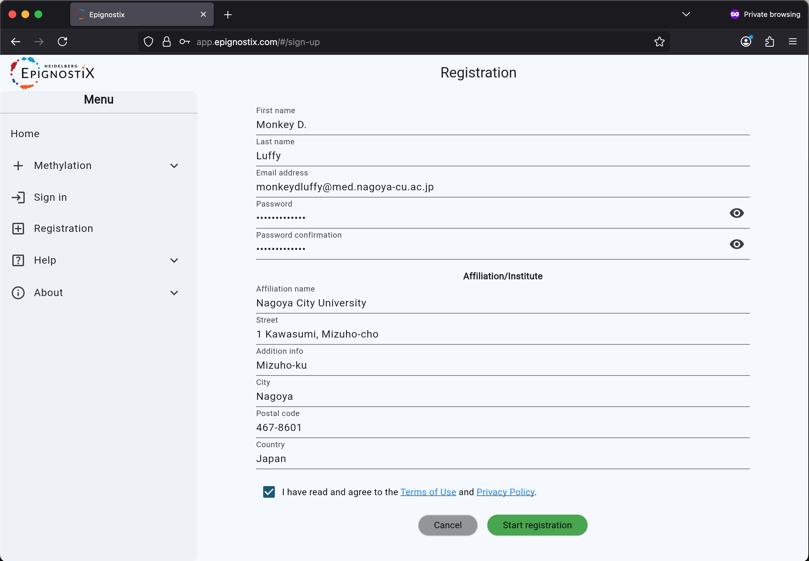
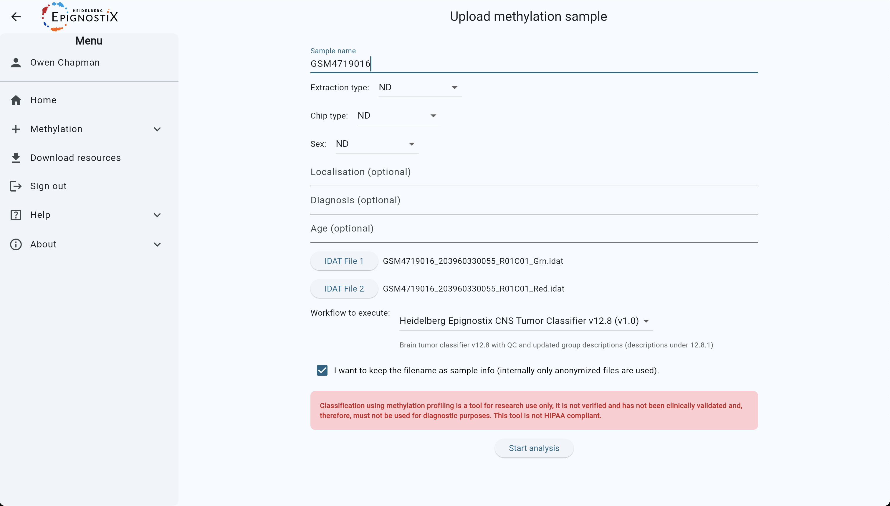
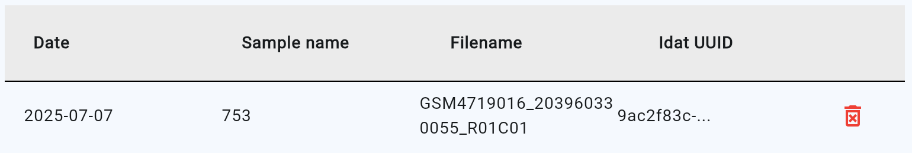
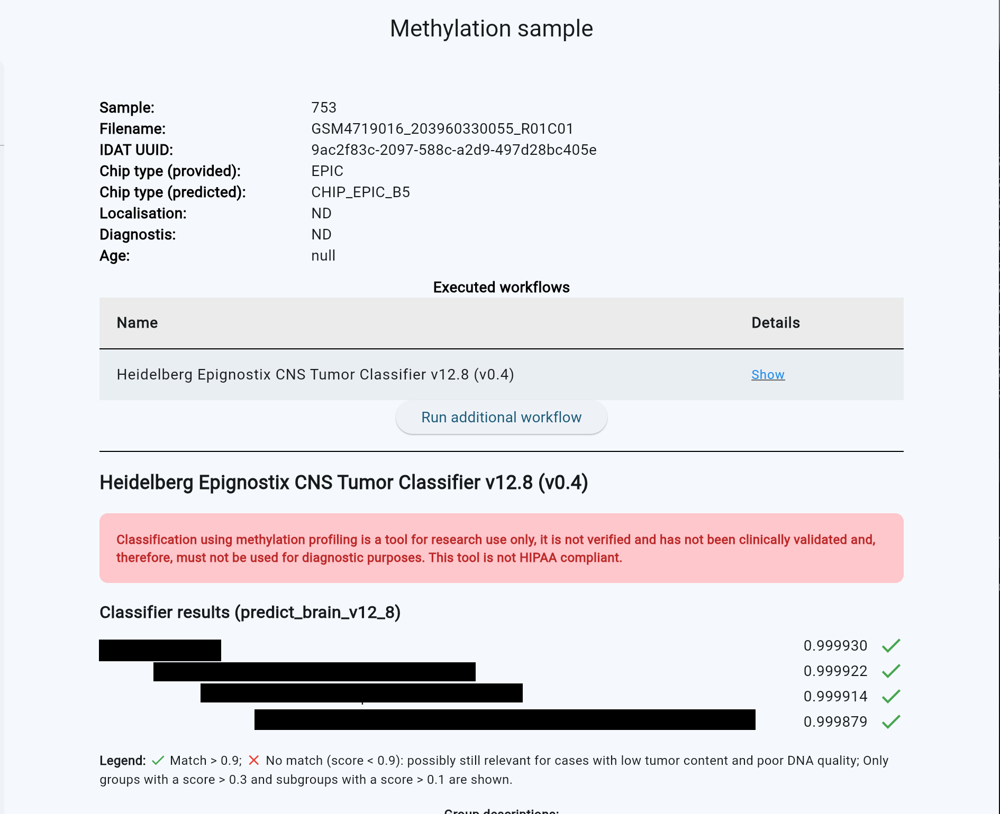

# メチル化データを用いた脳腫瘍分類

[English](README.md) | 日本語

> この文書は AI（Claude Opus 4.8）によって翻訳されました。誤りや不自然な表現が含まれている可能性があります。

更新日 2026-07-07

## 0. 依存パッケージ
本プロジェクトは、Jupyter ノートブックを用いて R で書かれています。メチル化データの処理には *minfi* パッケージを使用します。
- [R](https://www.r-project.org/)
- [minfi](https://bioconductor.org/packages/devel/bioc/vignettes/minfi/inst/doc/minfi.html)
- [jupyter lab](https://jupyter.org/try-jupyter/lab/?path=notebooks%2FIntro.ipynb)

依存パッケージの完全な一覧は [`environment.yml`](environment.yml) にあります。

## 1. インストール
このチュートリアルを genepattern.org のクラウド上、またはお使いのローカルコンピュータ上でセットアップするには、[インストールガイド](install.md) を参照してください。

## 2. データのアップロード
バイオインフォマティクスでは、しばしば大量のデータが必要になります。このチュートリアルでは、400 例の髄芽腫（medulloblastoma）のメチル化アレイデータを使用します。  
[MBlandscape_subset_400.RData]() をこのリポジトリの `./data/` ディレクトリにダウンロードしてください。

## 3. 解析の実行
これで、多くのデータと、それを解析するためのバイオインフォマティクスのソフトウェアツールがそろいました。
- コマンドライン（CLI）でこのリポジトリに移動し、`jupyter lab` を実行してノートブックのインターフェースを開きます。
- methylation-analysis-tutorial/methylation.ipynb を開きます。これは *Jupyter ノートブック* です。
- 先ほど conda でインストールした `methylation` 環境を使うために、*カーネル* を変更する必要があります。上部のメニューから `Kernel` > `Change kernel` > `methylation` を選択してください。
- 各セルのコードを上から順に、`Shift + Enter` で読みながら実行してください。

## 4. メチル化分類課題

セクション3のメチル化解析のデモでは、メチル化プロファイルに基づいて 400 件の脳腫瘍サンプルをクラスタリングする解析を実行しました。2018 年にこの手法が発表されて以来[^1]、著者らは数万件規模の固形腫瘍データセットを構築してきました。そのデータセットで学習された分類器は、研究用途に限り [https://app.epignostix.com/](https://app.epignostix.com/) にて公開されています。本課題では、未知の腫瘍サンプルのメチル化データをこの分類器に提出し、得られたレポートを読み解く演習を行います。

### 4.1 手順
- **アカウントを登録する。** [https://app.epignostix.com/#/sign-up/](https://app.epignostix.com/#/sign-up/) にアクセスし、必要な情報を入力してください。承認まで数日かかる場合があるので、しばらくお待ちください。

- **サンプルデータをダウンロードする。**  
[GSM4719016_203960330055_R01C01_Red.idat](https://www.dropbox.com/scl/fi/urf4zs2giqkolulvb7djn/GSM4719016_203960330055_R01C01_Red.idat?rlkey=c63f2jg1j8nkfwo6y3fip0jhr&st=1ey4rl1c&dl=0)  
[GSM4719016_203960330055_R01C01_Grn.idat](https://www.dropbox.com/scl/fi/s1ldcy1gudskz40f90b76/GSM4719016_203960330055_R01C01_Grn.idat?rlkey=qb6hxtb1l8q9g5isofw2i4utn&st=jm8pizpc&dl=0)  
[^2]
- **サンプルをアップロードする。** `app.epignostix.com` の web ページの左側で、`"Methylation"（メチル化）` > `"Upload sample"（サンプルをアップロード）` を選択します。サンプル名を入力し、idat ファイルを2つアップロードします。`"Heidelberg Epignostix CNS Tumor Classifier v12.8 (v0.4)"（ハイデルベルク CNS 腫瘍分類器）` を選択します。チェックボックスにチェックを入れ、`"Start analysis"（解析を開始）` をクリックします。

- **レポートを読む。** サンプルの解析が完了すると、`"Methylation"（メチル化）` > `"Sample list"（サンプル一覧）` の画面に表示されます。該当のサンプル名を選択します。

`"show"（表示）` をクリックしてレポートを確認します。

### 4.2 課題の問題
- **4.2.1** この髄芽腫の分類は、4つの分子サブグループ（WNT、SHH、Group 3、Group 4）のどれですか？ LMS の課題の選択肢から選んでください。

[^1]: Capper *et al.*, “DNA methylation-based classification of central nervous system tumors.” Nature 2018. 
[^2]: Riemondy *et al.*, "Neoplastic and immune single-cell transcriptomics define subgroup-specific intra-tumoral heterogeneity of childhood medulloblastoma." *Neuro Oncol* 2022.
